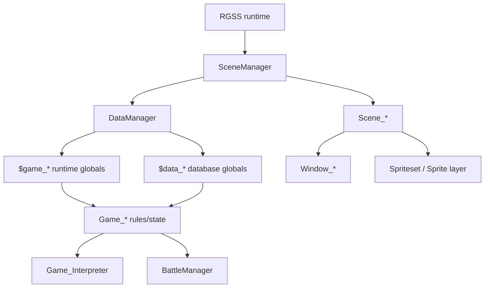
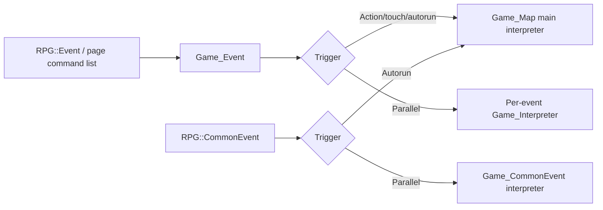

# Core Class and Subsystem Map

This reference answers one question first: **which layer owns the behavior?**

It is intentionally architectural rather than a copy of the default script source.

## High-level flow



## Boot and application control

### `SceneManager`

Owns the current scene and scene stack. It is the top-level coordinator for entering, calling, returning from, and exiting scenes.

Architectural implications:

- new full-screen modes normally become a `Scene_*` class;
- menu-like screens generally use `SceneManager.call` semantics so they can return to the caller;
- destructive scene transitions should be distinguished from stack-based calls;
- startup behavior should not be patched casually because it affects all game execution.

### `DataManager`

Owns database loading, runtime-object creation, new-game setup, and save/load serialization.

Patch here when the feature genuinely concerns persistence, database loading, or new-game initialization—not merely because a value must be accessible globally.

## Static editor/database data

### `RPG::*`

These are data structures representing editor-authored content: actors, classes, skills, items, weapons, armors, enemies, troops, states, animations, tilesets, maps, events, event commands, and related structures.

Typical access is through globals such as:

- `$data_actors`
- `$data_classes`
- `$data_skills`
- `$data_items`
- `$data_weapons`
- `$data_armors`
- `$data_enemies`
- `$data_troops`
- `$data_states`
- `$data_animations`
- `$data_tilesets`
- `$data_common_events`
- `$data_system`
- `$data_mapinfos`

Treat these as **definitions/configuration**, not as the best place for mutable player progress.

## Runtime game state

Important singleton-like runtime globals include:

- `$game_temp` — transient coordination state;
- `$game_system` — game-wide persistent system state;
- `$game_timer` — timer state;
- `$game_message` — current message/UI communication state;
- `$game_switches` — switch values;
- `$game_variables` — variable values;
- `$game_self_switches` — map/event-scoped self-switch values;
- `$game_actors` — actor instances;
- `$game_party` — player party/inventory/battle-party state;
- `$game_troop` — current battle troop runtime state;
- `$game_map` — current map state and map interpreter;
- `$game_player` — player character and transfer/movement state.

## Core inheritance families

### Battlers

```text
Game_BattlerBase
└── Game_Battler
    ├── Game_Actor
    └── Game_Enemy
```

Use this family for stats, states, buffs/debuffs, traits, costs, damage interaction, actionability, and actor/enemy-specific behavior.

A useful routing rule:

- trait/parameter calculation -> usually base layer;
- action execution/effects/state changes -> battler/action layer;
- actor-only equipment/class/experience -> `Game_Actor`;
- enemy-only actions/drops/transform behavior -> `Game_Enemy`.

### Units

```text
Game_Unit
├── Game_Party
└── Game_Troop
```

Use unit-level logic for aggregate party/troop behavior, member selection, all-dead checks, agility aggregation, battle membership, and inventory/party concerns where applicable.

### Map characters

```text
Game_CharacterBase
└── Game_Character
    ├── Game_Player
    ├── Game_Event
    ├── Game_Follower
    └── Game_Vehicle
```

Use this family for movement, position, passability interaction, routes, event characters, followers, and vehicles.

### Scenes

```text
Scene_Base
├── Scene_Map
├── Scene_Battle
├── Scene_Title
├── Scene_Gameover
└── menu/file/shop/name/etc. scene families
```

`Scene_Base` establishes the lifecycle. Specialized scenes coordinate windows, spritesets, user input, and transitions.

### Windows

```text
Window
└── Window_Base
    └── Window_Selectable
        └── Window_Command
            └── specialized command windows
```

Not every specialized window follows only this chain, but this is the central UI inheritance path.

Use:

- `Window_Base` for common drawing/layout helpers;
- `Window_Selectable` for cursor/index/selection behavior;
- `Window_Command` for command lists and handlers;
- scene classes for cross-window orchestration.

## Event execution ownership



The event definition is data. The `Game_Event` runtime object determines which page is active and how it triggers. `Game_Interpreter` executes the command list.

## Battle ownership

A useful conceptual split:

- `Game_BattlerBase` — traits/parameters/rates and basic battler state;
- `Game_Battler` — actions, states, damage/effects and battle-changing behavior;
- `Game_Action` — action target/evaluation/effect application pipeline;
- `Game_Actor` / `Game_Enemy` — side-specific rules;
- `Game_Party` / `Game_Troop` — unit-level state;
- `BattleManager` — battle phase coordination, command flow, result processing;
- `Scene_Battle` — battle screen/UI orchestration;
- battle windows/spriteset — presentation/input/visuals.

Do not patch `Scene_Battle` for a pure damage-math change, and do not patch `Game_BattlerBase` merely to change a battle window.

## Data-flow rule of thumb

Ask four questions:

1. Is this editor-authored **definition**? -> `RPG::*` / `$data_*`.
2. Is this mutable **game state**? -> a `Game_*` owner / `$game_*`.
3. Is this **screen/control flow**? -> `Scene_*` or a manager.
4. Is this **presentation/input**? -> `Window_*`, sprite/spriteset, Input/Graphics layer.

## High-risk extension zones

Treat these as collision-prone because many scripts modify them:

- `DataManager` save/load hooks;
- `SceneManager` startup/transitions;
- `Game_BattlerBase` parameter/trait methods;
- `Game_Battler` damage/effect/state pipeline;
- `Game_Action` targeting/effect logic;
- `BattleManager` turn/result flow;
- `Scene_Battle` command/action sequencing;
- `Game_Interpreter` command handling;
- `Game_Map` interpreter/event refresh flow;
- `Window_Base` text/drawing methods;
- `Window_Selectable` input/handler behavior.

Before modifying one of these, run the compatibility workflow.
